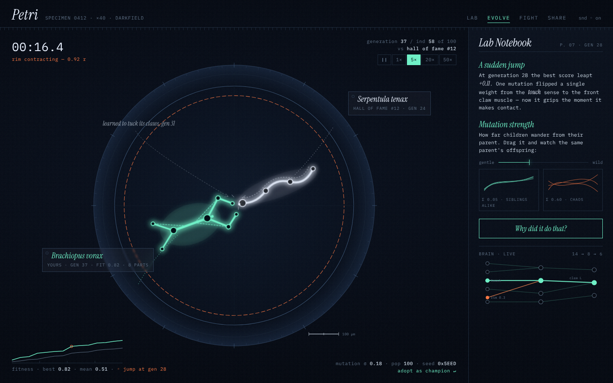

# Petri

Design a micro-creature, evolve its neural-network brain by natural selection,
then push your rivals out of the dish.

*Work in progress — Stage 0 of 6.* See [docs/PLAN.md](docs/PLAN.md) for the plan
and [docs/LEARN.md](docs/LEARN.md) for a beginner-friendly tour.



## Run it locally

```bash
npm install
npm run dev      # open http://localhost:5173 (mockup at /mockup.html)
npm test         # unit tests
npm run build    # production build into dist/
```
