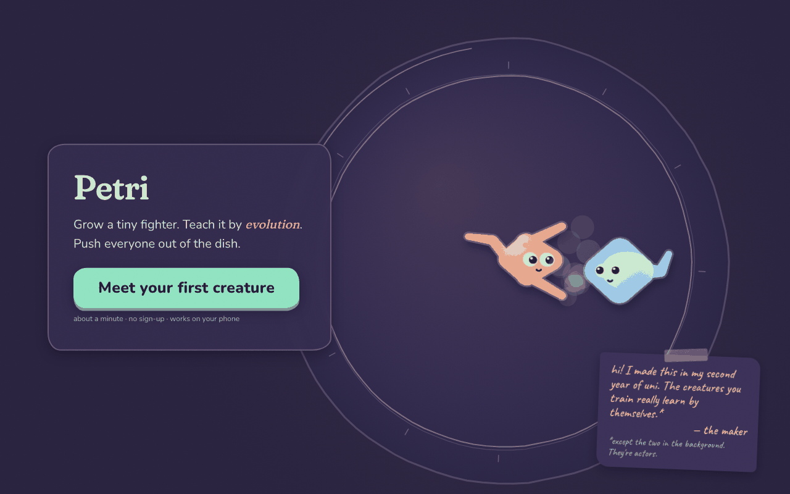

# Petri

Design a micro-creature, evolve its neural-network brain by natural selection,
then push your rivals out of the dish.

*Work in progress: Stage 2 of 6 done.* **Play it:** https://wegotthislol.github.io/petri/ · See [docs/PLAN.md](docs/PLAN.md) for the plan
and [docs/LEARN.md](docs/LEARN.md) for a beginner-friendly tour.



**Evolution really works:** every generation's champion, tested on fresh seeds.


Also: [creature sheet](https://wegotthislol.github.io/petri/creatures.html) · [design mockup](https://wegotthislol.github.io/petri/mockup.html) · [design language](docs/DESIGN.md)

## Run it locally

```bash
npm install
npm run dev      # open http://localhost:5173 (mockup at /mockup.html)
npm test         # unit tests
npm run build    # production build into dist/
npm run e2e      # browser smoke test (needs `npm run dev` running)
node scripts/first-run.mjs   # first-time-visitor walkthrough with screenshots
```
