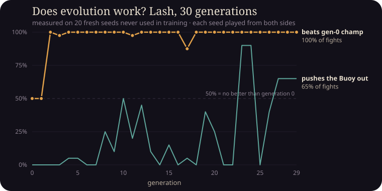

# Learning from Petri

A beginner-friendly tour of how this game is built. Written for someone who
knows C++ but not TypeScript, the web, or git. Updated at every stage.

---

## 1. The big picture (Stage 0)

Petri is a **static website**: just HTML, CSS and JavaScript files. There is
no server doing work for you — every fight, every generation of evolution,
runs inside the player's browser. That's why it can be hosted for free on
GitHub Pages.

The code is split into layers, like a C++ project split into libraries:

| Folder | Role | C++ analogy |
|---|---|---|
| `src/sim/` | The physics + rules of a match. Pure maths, no graphics. | A header-only library with no I/O |
| `src/evo/` | The genetic algorithm that evolves brains | An optimiser that calls the library |
| `src/render/` | Draws the current state on a `<canvas>` | The "view" in MVC |
| `src/ui/` | Buttons, screens, panels | The GUI layer |
| `src/workers/` | Runs many simulations in parallel threads | `std::thread` pool |

**The one rule:** `sim/` must never depend on `render/` or `ui/`. That way the
same simulation runs on a web page, in a background thread, or in a Node.js
test with no screen at all ("headless").

### Why determinism matters
If you give the simulation the same two creatures and the same *seed* (a
starting number for the random generator), it must produce exactly the same
fight, bit for bit, on every computer. Then a replay is tiny: two creatures +
one number. Two tricks make this possible:

1. **Our own random number generator** (`src/sim/rng.ts`). `Math.random()`
   can't be seeded, so we use *Mulberry32*, which only uses 32-bit integer
   operations — the same on every machine. Think of it like `std::mt19937`
   with a fixed seed.
2. **Only "safe" floating-point maths in the simulation.** IEEE-754 (the
   standard behind `double` in both C++ and JS) guarantees `+ − × ÷ √` give
   identical results everywhere. Functions like `sin`, `cos`, `exp` are *not*
   guaranteed to match in the last bit across browsers, so the sim avoids them.
   That's also why we wrote our own small physics engine (see PLAN.md).

### TypeScript in 30 seconds, for a C++ programmer
- `let x = 3;` is like `auto x = 3;`. `const` means the variable can't be re-pointed.
- `function f(a: number): number { ... }` — types come *after* the name.
- `number` is always a 64-bit `double`. There is no `int`; `x >>> 0` is a trick
  to force a value into an unsigned 32-bit integer.
- `class` works much like C++, but every object lives on the heap and is
  garbage collected — no `delete`.
- TypeScript is compiled ("transpiled") to plain JavaScript; the types vanish
  at runtime, they only exist to catch bugs early, like a strict compiler.

---

## 2. Stage 1: physics, a creature, and a sumo match

### Files to read, in this order
1. `src/sim/physics.ts`: the physics engine (about 250 lines).
2. `src/sim/creature.ts`: what a creature *is* (joints, bones, muscles) and the hand-built crab.
3. `src/sim/match.ts`: the rules of sumo, plus the **sensors** each creature's controller reads.
4. `src/sim/controllers.ts`: two hand-written "brains" (the pusher and the dummy).
5. `src/render/renderer.ts` and `src/main.ts`: drawing it and the game loop.

### How a creature moves
A creature is a little machine of **joints** (point masses), **bones** (rigid
sticks) and **muscles** (springs whose target length the brain sets every tick:
`-1` = fully contracted, `+1` = fully extended).

There's no gravity (we look *down* into the dish), so how does anything move?
**Fluid drag.** Each bone feels drag that is ~40× stronger sideways than
lengthwise, like an oar in water. Flick a tail left and right and the sideways
slaps push water backwards, so the body goes forwards. That's how a tadpole
swims. `tests/match.test.ts` checks it really happens.

### Position Based Dynamics (PBD) in four lines
Every small step (1/160 of a simulated second):
1. `velocity += force / mass * dt` (muscles and drag)
2. `position += velocity * dt`
3. Nudge positions until the bones have their right length again and nobody overlaps.
4. `velocity = (new position − old position) / dt`

Step 3 is the trick: instead of computing huge forces for rigid bones (which
explodes numerically), we *move* the points directly. It's simple and very stable.

### Sensors: what a creature "knows"
Every tick each creature gets 12 numbers plus one per muscle (`S` in `match.ts`):
where the opponent is (in *its own* body frame, so "ahead" or "to my right"), how
far the rim is, its own speed, whether it's touching someone, a built-in
rhythm (a triangle wave), and how stretched each of its muscles is. In Stage 2 a
neural network turns these numbers into muscle commands. For now
`PusherController` does it with hand-written rules.

### The game loop: fixed timestep + interpolation
Screens refresh at 60, 120 or 144 Hz, but the simulation must always advance
in identical ticks to stay deterministic. So `main.ts` keeps an *accumulator*:
real time flows in, whole ticks come out, and the renderer draws a blend
between the last two ticks so motion looks smooth at any refresh rate.

### How we know it works
- `npm test` runs the unit tests: determinism (same seed gives an identical
  match), a recorded fingerprint, physics stability under random muscle spasms,
  swimming, sumo rules, and "the pusher beats the dummy ≥18/20".
- `npm run e2e` (with `npm run dev` running) opens the game in headless Chrome,
  checks it draws, and checks the **browser's** simulation produces the same
  fingerprint as Node's. That's our proof of cross-engine determinism.

### C++ corner
- `Float64Array` is like `std::vector<double>` with a fixed size: fast, no boxing.
- `readonly` ≈ `const` member. `private x` in a constructor's parameter list
  declares *and* assigns a member in one go.
- `interface` describes the shape of an object (like a struct with no code). Any
  object with those fields fits; there's no inheritance needed.

---

## 3. Design pass: tokens, creature art, and the first evolution

### Design tokens (one file restyles everything)
`src/ui/tokens.ts` holds every colour, font, size and animation curve.
`applyTokens()` copies them into CSS *custom properties* (`--c-mint`, `--f-ui`, …)
so stylesheets write `color: var(--c-mint)`, and the canvas code imports the same
object directly. Change `mint` once and every button and every canvas highlight follows.
(C++ analogy: one `constexpr` config header included by every module.)

### How a skeleton becomes a cute blob (`src/render/creatureArt.ts`)
1. Draw every bone as a fat capsule, every joint as a disc, fill the stiff triangles:
   overlapping shapes merge into one silhouette.
2. Paint spots/stripes with the `source-atop` blend mode: it only paints where pixels
   already exist, so patterns can't spill outside the body.
3. Draw the same shapes slightly fatter in a darker colour with `destination-over`
   ("draw *behind*"). Only a thin rim shows, which gives one smooth outline.
4. Add the face, then stamp the whole thing onto the screen with a soft shadow and
   a little squash-and-stretch in the direction of motion.
The physics never sees any of this, so looks can change freely without breaking replays.

### The first evolution (a preview of Stage 2)
- **Brain** (`src/sim/brain.ts`): a tiny neural network, sensors → 10 hidden neurons
  → one output per muscle. Each neuron computes `softsign(Σ input×weight + bias)`.
  The *genome* is just the list of all weights (a few hundred numbers).
- **Genetic algorithm** (`src/evo/ga.ts`): test all brains, keep the best 3 unchanged
  (*elitism*), pick parents by mini-tournaments (*selection*), mix two parents
  weight by weight (*crossover*), nudge ~12% of a child's weights randomly (*mutation*).
- **Fitness** (`src/evo/fitness.ts`): points from short fights. A real push-out is
  worth 1, outlasting the shrinking rim only 0.45, plus small bonuses for being close
  and moving the opponent outward ("shaping", so clueless beginners have a slope to climb).
- **Web Workers** (`src/evo/pool.ts`): the population is split across background threads
  (one per CPU core), so the page stays smooth while hundreds of fights run.

#### A real bug evolution found for us
At first, *random* brains beat Globby nearly 100% of the time. Why? Globby's tiny wiggle
made it slowly swim backwards, out of the dish, so it always lost when the rim shrank.
Evolution doesn't care *how* points are earned, which is exactly the "reward hacking"
lesson the Lab Notebook will teach later. Fix: Globby sits still, and outlasting the rim
is worth far less than a real push.

---

## 4. Stage 2: making evolution honest (and proving it works)

### Who do they fight? (`src/evo/schedule.ts`)
Each brain's "exam" is 4 short fights: Globby twice, the latest champion once, and one
random **older** champion once. The older champions are the *hall of fame*.
- Only fighting Globby teaches one trick ("push the sleepy blob").
- Only fighting the latest champion can go in circles: A beats B, B beats C, C beats A,
  and evolution chases its tail forever (*cycling*, like rock-paper-scissors).
- Mixing in old champions means a new trick only counts if it doesn't forget how to beat
  old ones. This is called **self-play against a hall of fame**, and it's the same idea
  used to train game-playing AIs.
- Seeds change every generation, so no brain can memorise one particular fight.

### Anti-cheat: closing loopholes (`src/evo/fitness.ts`)
Evolution optimises *exactly* what you score, loopholes included. That's **reward hacking**.
Three rules:
| Flag | What it catches | Penalty |
|---|---|---|
| `exploit` | ≥3 hits of the physics speed cap: it found a glitch | that fight scores 0 |
| `idle` | barely moved all match, hoping the rim gets the other guy | −0.2 |
| `camping` | sat in the middle third >70% of the match and never touched anyone | −0.2 |
Plus the earlier rule: outlasting the shrinking rim is worth 0.45, a real push-out 1.0.
The flags are counted per generation (`GenReport.flags`); the commentary mentions
reward hacking the first time lots of brains get flagged.

### The proof (`scripts/proof.ts`, `tests/evolution.test.ts`)
We evolve Wriggle for 30 generations, then test every generation's champion on
**20 fresh seeds never used in training**, each seed played from both sides:
- vs the generation-0 champion: 50% (by definition) → 100% from generation 1 on.
  (The generation-0 champion is just the luckiest random brain, so this saturates fast.)
- push-outs vs Globby: 0% for gens 0–5 → 35% by generation 9, which holds steady to 30.

The unit test runs a shorter version (8 generations, default settings) and requires
generation 7 to beat generation 0 in more than 60% of fights. It gets 100%.
**Honest notes:** with a population of 24 instead of 48, 10 generations was *not* enough
in our run (40%). Small populations are noisy. And progress against Globby shows up
later (gen 9+) than progress against rivals, because self-play mostly rewards beating rivals.

### Speed trick: a broadphase
Most of the time the two creatures are far apart, yet we were checking every joint
against every bone for collisions. Now each substep first compares the two creatures'
padded bounding boxes; if they don't overlap, collisions are skipped entirely. Same
results bit for bit (the fingerprint test proves it), about 2.5× faster training.

---

## 5. Design correction: how the glassy organisms are drawn

`src/render/creatureArt.ts` now draws each creature in layers on a scratch canvas:
1. **Flesh**: the silhouette is filled several times, each time slightly *thinner* and a little
   darker. The edge ends up pale and thin, the middle dense, which is how light behaves in glass or a jelly.
2. **Torso**: circles swept along the *spine* (the chain of joints from head to tail, found with a
   breadth-first search) with a tapering radius, so bodies are fish- or larva-shaped and bend as they swim.
3. **Inner structure, markings, pulse**: painted with `source-atop` so they stay inside the body.
   The pulse's brightness is the average |activation| of the hidden neurons, so you see the brain work.
4. **Rim light**: on a second canvas, draw the body, then cut out a slightly smaller copy nudged toward
   the light (`destination-out`). What remains is a thin bright crescent on the lit edge.
5. **Sensor lights**: additive (`lighter`) glows at the head (opponent sense) and flanks (rim sense),
   driven by the same sensor numbers the brain receives.

---

## 6. Stage 3: research, the Lab, and the full loop

### What the research changed (see RESEARCH.md for sources)
- **Opponents from history, not just the latest.** OpenAI's sumo agents trained against their
  newest rival became lopsided; sampling *old* versions worked better. `src/evo/schedule.ts` now
  picks one hall-of-fame opponent from the recent half and one from the whole history.
- **Curricula.** Early on, generous "shaping" bonuses (be close, push outward) give clueless
  brains a slope to climb; they fade over 20 generations so winning matters most. Start positions
  also get more random over time. We keep 30% of the shaping instead of fading to zero, because
  our own experiment showed champions otherwise stopped bothering to push the Buoy. *Research ideas
  still have to be tested on your own problem.*
- **Effort cost.** A tiny penalty for twitching muscles makes motion smoother.

### The Lab (`src/ui/lab.ts`)
- The editor keeps the body as plain data (`CreatureSpec`) and redraws it every frame with the
  same organism renderer used in fights, plus a skeleton overlay.
- Pointer events (`pointerdown/move/up`) work for mouse and touch alike. `setPointerCapture` keeps
  the drag going even if the pointer leaves the canvas.
- **Undo** is a stack of JSON snapshots: before each edit, push a copy; undo pops it back.
- **Validation** (`validateSpec` in `creature.ts`) runs a depth-first search over bones to check that
  every joint is attached to the body. Muscles alone don't hold a body together.
- **Test swim** spawns the body in a private physics world and drives every muscle with a sine wave,
  phase-shifted per muscle, so you see whether the shape can move at all before evolving a brain.

### Saving (`src/ui/save.ts`)
`localStorage` is a small key-value store in the browser. We save the body and the champion's
genome (a few hundred numbers). Every access is wrapped in `try/catch`, because private browsing
can block storage. On "Continue", `Evolution.seedWith()` fills the new population with the saved
champion and mutated copies of it.

---

## 7. Stage 4: smoother motion, a roster, share links and clips

### Why the creatures jittered, and the fix
Evolved brains love *bang-bang control*: slamming a muscle from fully contracted to fully
extended in one tick. We measured it: champions did a full flip on 10–23% of all ticks.
Three fixes, each measured (`scripts/` experiments, numbers in CHANGELOG):
1. **Muscle response time** (`PHYS.muscleResponse = 0.5`): each tick the real activation closes half the
   gap to the brain's command, like real muscle. We tried 0.25 first: smoother, but tail-swimmers
   could no longer push (Lash: 0–6 push-outs in 10). 0.5 kept pushing strong (9 in 10).
2. **A bigger effort cost** in fitness (0.1 → 0.3): evolution itself now prefers calm commands.
   Pincer's body jerk dropped by a third with no loss of push-outs.
3. **Display smoothing**: the renderer eases drawn joint positions over ~40 ms. Only the picture
   changes; the simulation, and therefore every replay and share link, is untouched.
*Lesson:* when a fix trades one quality for another, measure both before deciding.

### The champion roster (`scripts/train-all.sh`, `scripts/build-roster.ts`)
Each body plan is evolved offline (64 variants × 80 generations, four in parallel, one per CPU core).
From the last 20 champions we keep the one that does best on fresh seeds, counting real
push-outs double. `build-roster.ts` then measures each champion against the Buoy and in a round
robin against each other, and writes its personality line *from those numbers*. The roster is the
home-screen background, the example shown behind the pick screen, and a list of opponents.

### Share links (`src/share/codec.ts`)
A creature is packed into bytes: joint positions as 16-bit integers, bone and muscle pairs as
4-bit nibbles (≤12 joints fit), colours as indices, and the brain's weights **quantised** to 8 bits
each (a weight ≈ q × scale, with one shared float `scale`). That's ~250–340 bytes, base64url-encoded
into ~400–490 characters after `#c=`. Because everything after `#` never reaches a server,
nothing is uploaded: the link *is* the creature. Fights use the decoded (quantised) brain, so the
sender and every receiver see exactly the same fight.
*C++ analogy:* it's like `memcpy`-ing a packed struct into a byte buffer, then hex-encoding it.

### Clips (`src/share/clip.ts`)
`canvas.captureStream()` turns the canvas into a video track and `MediaRecorder` encodes it (MP4 where
supported, else WebM). We don't record the live fight: we **replay** it, same creatures and same seed,
with a caption drawn in, and download the result. Determinism makes this free.

---

## Glossary

### Git terms
- **Repository (repo)** — a project folder whose full history is tracked by git.
- **Commit** — a saved snapshot of the files, with a message saying what changed.
- **Branch** — a parallel line of commits. We work on `claude/epic-carson-walyhr`
  so the main line (`main`) stays clean until you merge.
- **Push** — upload your local commits to GitHub.
- **Merge / Pull Request (PR)** — bringing one branch's commits into another;
  a PR is GitHub's page for reviewing that before it happens.
- **`.gitignore`** — a list of files git should not track (e.g. `node_modules/`,
  the downloaded libraries, which can be re-installed any time).

### Web / tooling terms
- **Node.js** — runs JavaScript outside the browser (like running a compiled
  binary from the terminal). We use it for tests and scripts.
- **npm** — Node's package manager (like `vcpkg`/`apt` for JS libraries).
  `package.json` lists the libraries; `package-lock.json` pins exact versions.
- **Vite** — the build tool: a fast dev server while coding, and a bundler that
  produces the final optimised files in `dist/`.
- **Vitest** — the unit-test framework (like GoogleTest).
- **Playwright** — drives a real (headless) Chrome so we can take screenshots
  and check the game actually renders.
- **Canvas** — an HTML element you draw pixels/shapes on from code.
- **Web Worker** — a background thread in the browser. It can't touch the page,
  only send/receive messages — perfect for running simulations.
- **WASM (WebAssembly)** — a compact binary format browsers can run at near
  native speed; C++ can compile to it. (We chose *not* to use a WASM physics
  engine — see PLAN.md.)
- **GitHub Pages** — free static-site hosting from a GitHub repo.
- **GitHub Actions / workflow** — scripts GitHub runs on its servers when you
  push (ours: install → test → build → publish to Pages). Lives in
  `.github/workflows/deploy.yml`.
- **Headless** — running without a visible window or screen.
- **requestAnimationFrame** — asks the browser to call your function before the next screen repaint; the heartbeat of a web game loop.
- **devicePixelRatio** — how many physical pixels per CSS pixel (2 on most phones); we scale the canvas so it stays sharp.
- **Quantisation** — storing a number with fewer bits (here 8), accepting a small rounding error.
- **base64url** — writing bytes as URL-safe text (A–Z, a–z, 0–9, '-', '_').
- **URL fragment (#…)** — the part after '#'; browsers never send it to the server.
- **MediaRecorder** — browser API that encodes a media stream (e.g. a canvas) into a video file.
- **localStorage** — a per-site key-value store in the browser; survives reloads, not shared between devices.
- **Curriculum** — training that starts easy and gets harder (or less helped) over time.
- **Hall of fame / self-play** — training against copies of your own past champions.
- **Broadphase** — a cheap first check (e.g. bounding boxes) that rules out most collision pairs before the expensive exact check.
- **CSS custom property** — a variable in CSS (`--c-mint: #8fe3c0;` then `var(--c-mint)`).
- **Composite operation** — how new canvas drawing combines with what's already there (`source-atop`, `destination-over`…).
- **Multi-page Vite build** — several HTML entry points (`index.html`, `mockup.html`, `creatures.html`) built together.
- **tsx** — runs a TypeScript file directly in Node (`npx tsx scripts/probe.ts`), no build step.
